  

  <a href="https://github.com/namledev?tab=repositories">Projects</a> ·
  <a href="https://github.com/namledev/DMS">Currently building: DMS</a>

### A little about me

Hi, I'm **Nam Le**, a developer from **Viet Nam** interested in DevOps, cloud infrastructure, and automation.

- Building **DMS — Driver Monitor Tracking System**, with FastAPI and Next.js.
- Exploring ways to make development and deployment simpler.
- Sharing projects, experiments, and what I learn along the way.

### My toolbox

| Area | Technologies & interests |
| :--- | :--- |
| Backend | Python · FastAPI |
| Frontend | JavaScript · TypeScript · React · Next.js · Tailwind CSS |
| Infrastructure | Linux · Docker · Nginx |
| Workflow | Git · CI/CD · Automation |

### Currently building

**[DMS — Driver Monitor Tracking System ↗](https://github.com/namledev/DMS)**  
A team project for driver monitoring and trip management.

`FastAPI` `Next.js` `TypeScript` `Python`

**Stage:** foundation and feature development. Working toward driver and vehicle management, trips, GPS, and monitoring events.

---

Small steps. Thoughtful systems. A little sakura along the way.

